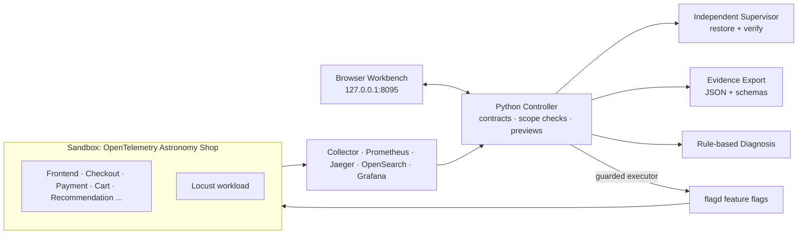

<div align="center">

# Faultline

**Safe, bounded, evidence-driven payment chaos experiments for microservice systems.**

Built around the pinned [OpenTelemetry Astronomy Shop](https://github.com/open-telemetry/opentelemetry-demo)


[Current status](IMPLEMENTATION_STATUS.md) · [Release & demo guide](docs/release-and-demo.md) · [Task plan](IMPLEMENTATION_PLAN.md) · [Payment failure plan](docs/payment-failure-plan.md)

</div>

---

## Why this project

Chaos engineering is only useful if it is **safe to run** and **easy to learn from**. Most tools inject a fault and leave the operator to guess what happened, or worse, to clean up manually.

Faultline is a payment-chaos development platform that treats **safety and evidence as first-class features**:

- **Bounded experiments:** every experiment has a target allowlist, a hard deadline, and abort thresholds.
- **Independent restoration:** faults are restored by a separate supervisor, not only by the process that injected them.
- **Evidence by default:** timestamped baseline, fault, rollback and recovery observations are exported with source identifiers.
- **Free diagnosis:** a rule-based engine explains what happened. No model API key is needed.
- **One workbench:** a browser UI served from the same origin as the controller, showing real controller state.

## Highlights

| Capability | What it does |
|---|---|
| **Deterministic controller** | Python controller records experiments, enforces scope, and previews actions before anything runs. |
| **Safety contract** | One active experiment at a time, healthy-baseline requirement, hard deadline, threshold abort, missing-observation handling, manual kill switch, automatic restoration, verified recovery. |
| **Independent supervision** | Restoration is verified by a separate supervisor. |
| **Evidence export** | Structured JSON records with timestamps and source identifiers, backed by exported JSON Schemas. |
| **Rule-based diagnosis** | Free, offline diagnosis of experiment outcomes. |
| **Browser workbench** | Same-origin UI connected to live controller state, plus a fixture mode for demos. |
| **Reproducible target** | Pinned upstream release (3.1.0), versioned images, isolated Compose project, loopback-only ports. |

## Architecture



## Project status

This is a working prototype. We are explicit about what is and is not proven.

| Area | State |
|---|---|
| P0–P6: controller, contracts, workbench, evidence, diagnosis | Integrated in code |
| P7: packaging, CI, branch delivery | Provided, with an explicitly **simulated** demonstration |
| Live acceptance against the running shop | **Pending** |
| Complete payment repair flow | **Pending** |
| Fault execution | **Disabled** until dedicated-sandbox and measured-baseline requirements pass |

> The fixture records and the portable `scripts/demo_controller.py` demonstration are illustrative. They do **not** certify live payment behavior.

Details: [IMPLEMENTATION_STATUS.md](IMPLEMENTATION_STATUS.md) · [P5/P6 integration guide](docs/p5-p6-integration.md)

## Quick start

```sh
git clone --recurse-submodules https://github.com/0Advi/faultline.git
cd faultline

python3.13 -m venv .venv
. .venv/bin/activate
python -m pip install -r requirements-dev.txt

make test              # Python test suite
make test-workbench    # Workbench tests (Node 20+)
make release-check     # Release gate checks
make eval-baseline     # Baseline evaluation
make workbench         # http://127.0.0.1:8095 (real controller state)
```

Prefer a quick look without the full stack?

```sh
make workbench-fixture            # http://127.0.0.1:8096 (illustrative records)
python scripts/demo_controller.py # portable simulated demonstration
```

If you cloned without submodules, run `make bootstrap`.

## Running the sandbox shop

**Prerequisites:** Python 3.10+, Go 1.20+, Git, Make, Docker (daemon running), Docker Compose **2.24.4+**, and a **dedicated local sandbox Docker environment**. Upstream estimates about 3 GB RAM and 14 GB disk for minimal mode; usage for this project has not been measured.

```sh
make validate   # configuration checks, no Docker daemon needed
make start      # pull images and start the sandbox (waits up to 300 s for health)
make status
make smoke      # home page, products, recommendations, Prometheus readiness
make verify     # synthetic cart/checkout + telemetry checks → artifacts/startup_verification.json
make stop       # tear down the Compose project (volumes are not deleted)
```

| Interface | URL |
|---|---|
| Shop | http://localhost:8080/ |
| Grafana | http://localhost:8080/grafana/ |
| Jaeger | http://localhost:8080/jaeger/ui/ |
| Locust | http://localhost:8080/loadgen/ |
| Feature flags | http://localhost:8080/feature/ |
| Prometheus | http://localhost:9090/ |

Change `FAULTLINE_APP_PORT` or `FAULTLINE_METRICS_PORT` in `deploy/demo.local.env` (Git-ignored) if a port is taken. You can also select the Docker Hub mirror there with `IMAGE_NAME=docker.io/otel/demo`.

`make smoke` and `make verify` are startup checks. They are **not** a healthy baseline and do not execute a fault. Keep the upstream random feature-flag scheduler idle and failure flags at their resting settings during baseline and experiments.

`make start` requires Go to compile a small static payment health probe for the Docker daemon architecture, avoiding repeated loads of Node telemetry instrumentation inside the health check. The generated executable stays local. The sandbox gives checkout and product catalog 128 MiB each, including their health-check processes; remeasure baselines after resource-budget changes.

For development source builds: `make build`, then `FAULTLINE_SOURCE_BUILD=true make start`. These use separate `faultline-local/demo:3.1.0-source-<service>` image names so official images are never overwritten.

## AI Chaos Lab (live demo)

`demo/` is a self-contained, presentation-ready layer on top of the sandbox: an AI planner proposes experiments, a guarded engine injects one real fault while synthetic customers use every shop path, and LangGraph agents explain the outcome and propose a code fix.

```sh
python -m pip install -r demo/requirements.txt
cp .env.example .env            # add a free GEMINI_API_KEY (or GROQ_API_KEY)
make start                      # sandbox must be running
python -m demo.server           # http://127.0.0.1:8099
```

- **27 fault scenarios across 11 categories:** flagd faults built into the services (payment, cart, catalog, ads, email, recommendation, DB lock contention, slow images, shipping), container crash, hang, network partition, CPU starvation, database overload, traffic spike, traffic spike plus crash, and **7 network-layer faults** (latency and jitter, packet loss, bandwidth limit, corruption, a dropped or reset link between two services, DNS outage).
- **Network layer:** a dashboard panel shows the Docker bridge (subnet, gateway), every container's IP, MAC, listening ports and traffic, and the network faults active right now. Network runs add TCP evidence from the fault container's own namespace (retransmissions, SYN retries, failed connects, resets, RTT) and per-hop network time from traces. See [Networking concepts](#networking-concepts-demonstrated).
- **Safety:** health gate before injection; auto-stop when the shop goes down, the blast radius spreads to unrelated paths, or error rate or latency exceed limits; 60 s hard cap; kill switch. Every fault is journaled before it is applied and restored on finish, abort, crash or restart. Flag restores are verified against what flagd actually serves.
- **Evidence:** 10 customer paths probed independently, Jaeger error chains, Prometheus span-metric errors, container logs and state, blast radius versus the dependency graph, and a deterministic 0-100 resilience score.
- **Agents (LangGraph):** *planner* (dependency map → ranked experiments → safety validator), *analyst* (read-only tools → ranked findings → code fix that is syntax-checked and retried → grounding reviewer), *campaign* (ranked weaknesses across runs). Uses free-tier Gemini with automatic model fallback on quota limits.
- **Auto-fix:** validated fixes to interpreted services (payment, recommendation, email) are hot-patched through a generated Compose overlay with rollback. The same experiment is then re-run and compared. Compiled services get a saved patch for an image rebuild.
- **Report:** Markdown findings report export. See [docs/PRESENTATION.md](docs/PRESENTATION.md).

## Networking concepts demonstrated

The network faults act at the Linux kernel level inside one container's **network namespace**, using
the same tools an SRE uses on a real host. A short-lived helper container ([deploy/nettools](deploy/nettools/Dockerfile),
Alpine + iproute2 + iptables) is started with `--network container:<target>`, so it shares that
namespace and changes nothing else. Implementation: [demo/netem.py](demo/netem.py), evidence: [demo/network.py](demo/network.py).

| Scenario | Mechanism | Concept it shows |
|---|---|---|
| Network latency + jitter | `tc qdisc replace dev eth0 root netem delay 300ms 100ms distribution normal` | Queueing discipline on egress; RTT budget vs client timeouts |
| Packet loss | `tc ... netem loss 15%` | TCP retransmission and retransmission timeouts (RTO) turning loss into tail latency |
| Bandwidth limit | `tc ... tbf rate 256kbit burst 32kbit latency 400ms` | Token-bucket shaping; throughput vs latency for large vs small responses |
| Corruption + duplication | `tc ... netem corrupt 5% duplicate 5%` | Checksums discard corrupt segments; TCP sequence numbers de-duplicate |
| Silent link failure | `iptables -I OUTPUT -d <peer-ip> -j DROP` in the caller only | Partial partition; SYNs vanish so callers hang until their connect/RPC deadline |
| Connection reset | `iptables ... -p tcp -j REJECT --reject-with tcp-reset` | RST makes failure immediate: fail-fast vs hang (compare with the DROP case) |
| DNS outage | `iptables ... -d 127.0.0.11 -j DROP` (UDP and TCP) | Docker's embedded resolver; only *new* connections fail, pooled ones survive |

How each run measures the network:

- **Rules verified in the namespace** right after injection (`tc qdisc show`, `iptables -S`), not just "command succeeded".
- **TCP counters** from `nstat` (`TcpRetransSegs`, `TcpExtTCPSynRetrans`, `TcpAttemptFails`, `TcpOutRsts`, …) and connection **RTT** from `ss -ti`, baseline window vs fault window.
- **Per-hop network time** from Jaeger: for each caller → callee call, client span duration minus server span duration separates time on the wire (and in transport stacks) from time inside the service.
- **Restore is verified**: the undo removes the qdisc and every rule tagged `faultline-fault`, then checks the namespace is clean. A crashed run is cleaned up from the fault journal on the next start; a restarted container gets a fresh namespace anyway.

## Safety model

Fault injection tooling must be trustworthy before it is powerful. The controller is designed around this contract:

1. **Target allowlist:** only approved services and flags can be touched.
2. **Single active experiment:** no overlapping faults.
3. **Healthy baseline required:** no fault on an unhealthy or unmeasured system.
4. **Hard deadline:** every experiment ends on time.
5. **Threshold abort:** protected shop workflows trigger rollback when they degrade.
6. **Missing-observation handling:** no data is treated as unsafe, not as success.
7. **Manual kill switch:** an operator can always stop and restore.
8. **Automatic, verified restoration:** recovery is confirmed, not assumed.

Isolation in the Compose overlay: no fixed container names, a dedicated `faultline-sandbox` project and network, no backend host ports, and only the shop and Prometheus exposed on `127.0.0.1`.

> **Note:** the upstream OpenTelemetry Collector mounts the Docker socket and host filesystem for observation. A read-only socket mount does not limit Docker API capabilities. Use a dedicated sandbox Docker daemon; the overlay reduces collisions and exposure but is not a substitute.

## What the shop runs

The selected upstream minimal deployment has **25 services**:

- **Shop:** Envoy proxy, Next.js frontend/API, ad, recommendation, product catalog, cart, checkout, currency, payment, email, shipping, quote, image provider.
- **State:** PostgreSQL (`astronomy-db`), Valkey (`valkey-cart`).
- **Workload and support:** Locust, flagd, flagd-ui, telemetry-docs.
- **Observation:** OpenTelemetry Collector, Prometheus, Jaeger, OpenSearch, Grafana, OpAMP server.

Kafka, accounting, fraud detection, the shopping AI agent/MCP/chatbot and profiling services are **not enabled**. Their code remains in the pinned submodule without becoming runtime dependencies.

**Experiment target:** payment is the focus, using the upstream payment failure and unreachable flags. See the [payment failure plan](docs/payment-failure-plan.md) and the typed [capability catalog](config/capabilities.yaml). The AI Chaos Lab's 20-scenario catalog is in [demo/catalog.py](demo/catalog.py). Payment execution needs its own baseline, guarded executor and verified restoration.

## Repository layout

```text
demo/                           AI Chaos Lab: faults, workload, evidence, agents, dashboard, auto-fix
controller/                     Contracts, bounded tools, scope checks, previews
schemas/                        Exported JSON Schemas for shared records
deploy/                         Compose overlay and Collector adjustment
scripts/demo.py                 Deployment validate/start/stop/smoke helper
scripts/verify_startup.py       Synthetic checkout and telemetry checks
scripts/demo_controller.py      Portable simulated demonstration
tests/                          Contract fixtures, rejection and restoration checks
artifacts/dependency_map.static.json   Static, unobserved architecture seed
docs/                           Architecture review, local preview, release/demo, integration
vendor/opentelemetry-demo/      Pinned Apache-2.0 upstream submodule
```

## Reproducibility

- Upstream pinned to official release **3.1.0**, commit `dedc0178918e260823323b8d95005a8cb924b007`. The helper refuses a changed upstream commit.
- Matching `ghcr.io/open-telemetry/demo:3.1.0-<service>` images are used instead of floating `latest` tags.
- `make validate` checks selected services, absence of fixed container names, loopback-only ports, versioned-image policy, project network and static-map scope.
- Record resolved image digests during runtime verification for stronger reproducibility.

## Roadmap

- [ ] Discovery and a repeatable, measured baseline
- [ ] Fast bounded API probes for short-experiment abort decisions
- [ ] Guarded payment executor with verified restoration
- [ ] Live acceptance run with saved, timestamped baseline / fault / rollback / recovery evidence
- [ ] Complete payment repair flow
- [ ] Enable execution once sandbox and baseline gates pass

Affected recommendation requests will be measured separately from protected shop workflows.

## Known limitations

- Live behavior is unverified. Current results come from fixtures and simulation.
- `dependency_map.static.json` is a static seed, not proof of runtime dependencies.
- Resource usage is not yet measured for this project.
- Default telemetry intervals can be too slow for short-experiment decisions.
- Upstream `make` telemetry-test targets manage their own deployment and should not be run unchanged against this customized deployment.

## License and references

Apache-2.0. See [LICENSE](LICENSE) and [NOTICE](NOTICE). Upstream attribution and licenses remain in the submodule.

- [OpenTelemetry Demo](https://github.com/open-telemetry/opentelemetry-demo)
- [Official architecture](https://opentelemetry.io/docs/demo/architecture/)
- [Official Docker deployment](https://opentelemetry.io/docs/demo/docker-deployment/)
- [Implementation status](IMPLEMENTATION_STATUS.md)
