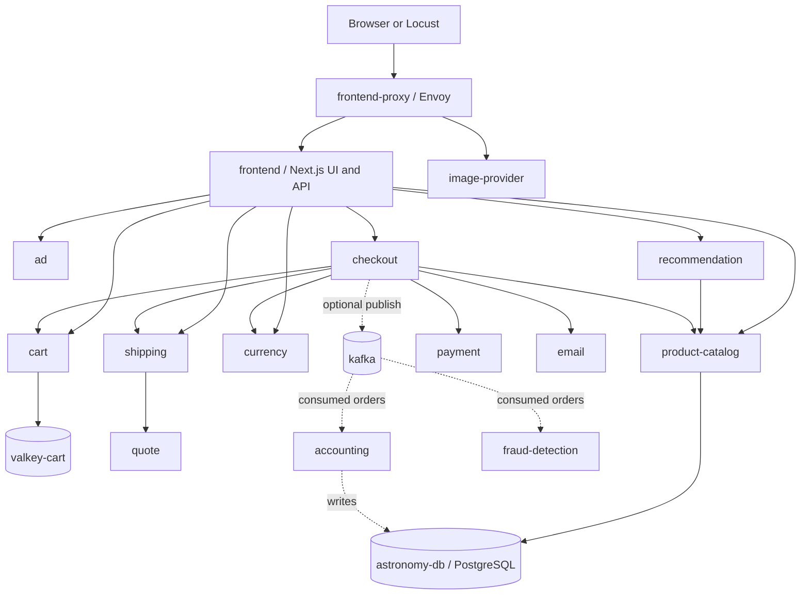
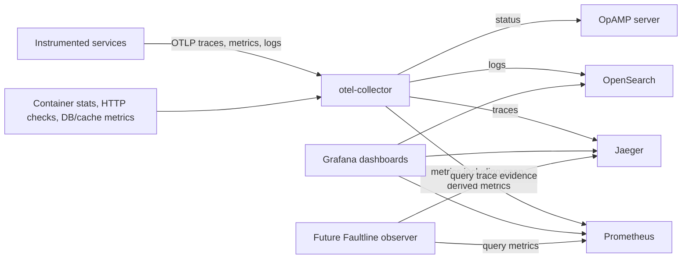
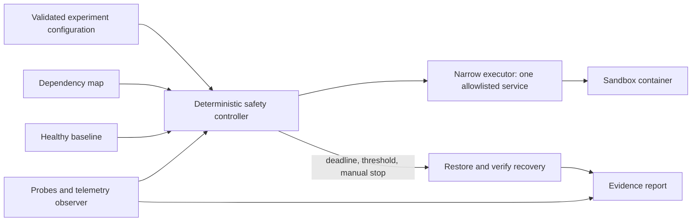

# Day 1: architecture and component selection

Deployment update: the localhost preview uses official release 3.1.0, source
commit `dedc0178918e260823323b8d95005a8cb924b007`, with matching versioned images.
The original main-branch review below is historical. The release retains the
same 25 selected services. Its Jaeger version uses `/jaeger/ui/api/services`
rather than the newer v3 endpoint discussed in the original source inspection.
See `IMPLEMENTATION_STATUS.md` for actual runtime evidence.

Reviewed 10 October 2026. Scope: read the two supplied briefs, inspect upstream source, map architecture, and recommend components. No application startup, controller implementation, or fault execution was performed.

Repository: [OpenTelemetry Demo](https://github.com/open-telemetry/opentelemetry-demo). Inspected commit: `e5552ee25bcede2900d89188f076c464cd73c074` (8 October 2026). The source is Apache-2.0 licensed. Source references below are pinned to this commit; deployment documentation is current upstream documentation.

## 1. What the briefs mean for this project

The project objective is controlled failure injection with measured impact, deterministic safety, recovery, and an evidence-based report. The supplied documents recommend OpenTelemetry Demo, Docker Compose, and Python; those choices are recommendations, rather than challenge-mandated technologies.

The user's current request is architecture and component selection only. The documents' instructions to start the app and implement subsequent phases are context for future work, not authorization to execute those phases in this review.

Use the demo as the application under test and its bundled tools as observation infrastructure. Build a small, separate Faultline controller later. The demo itself is not a complete chaos controller.

## 2. Repository architecture

The Astronomy Shop is a polyglot storefront. Its frontend has both a browser UI and server-side API routes. Envoy is the entry point. Most backend calls use gRPC; shipping, quote, and email use HTTP. PostgreSQL holds product/application data and Valkey holds carts. Kafka and its consumers form an optional asynchronous order-processing group.

The deployment files are intentionally layered:

| Layer | Files | What it contributes | Day 1 decision |
|---|---|---|---|
| Core shop | `compose.yaml` | 20 services, including Collector, load generator, PostgreSQL, Valkey, and feature flags | Keep the supported core intact |
| Observability | `compose.observability.yaml` | 5 additional services: Prometheus, Jaeger, Grafana, OpenSearch, OpAMP server; patches existing services | Keep initially |
| Kafka group | `compose.full.yaml` | Kafka, accounting, fraud detection; patches checkout and Collector | Defer |
| Shopping AI | `compose.agent.yaml` | Agent, MCP server, chatbot; patches proxy and load generator | Defer |
| Profiling | `compose.profiling.yaml` | eBPF profiler and Firepit | Defer |
| Customization | `compose.extras.yaml` | Empty extension seam | Use an external override for project-specific deployment changes |
| Existing tests | `compose.tests.yaml`, `test/telemetry/`, frontend Cypress tests | Test runners and checks | Reuse relevant checks during runtime verification |

The recommended configuration has **25 declared services**: 20 core plus 5 observability. Across the core, observability, full, agentic, and profiling layers there are 33 unique services. “Minimal” means omitting the Kafka group; it does not mean a three-service app.

Sources: [Compose core](https://github.com/open-telemetry/opentelemetry-demo/blob/e5552ee25bcede2900d89188f076c464cd73c074/compose.yaml), [observability layer](https://github.com/open-telemetry/opentelemetry-demo/blob/e5552ee25bcede2900d89188f076c464cd73c074/compose.observability.yaml), [Makefile](https://github.com/open-telemetry/opentelemetry-demo/blob/e5552ee25bcede2900d89188f076c464cd73c074/Makefile).

### Application flow

This diagram is a static interpretation of code/configuration, not a graph of observed traffic. Arrows represent calls; the Kafka branch is optional and shows order data flow.

`flagd` serves feature-flag decisions to multiple application services; `flagd-ui` edits the flag configuration. `telemetry-docs` serves generated instrumentation documentation. These supporting relationships are omitted from the diagram for readability.

Checkout only enables Kafka publishing when `KAFKA_ADDR` is set. That conditional code supports using the core deployment without the Kafka group. See [checkout implementation](https://github.com/open-telemetry/opentelemetry-demo/blob/e5552ee25bcede2900d89188f076c464cd73c074/src/checkout/main.go).

**Do not equate `depends_on` with business calls.** For example, frontend declares a startup dependency on quote, but the documented shipping call chain reaches quote through shipping. Services also declare Collector startup dependencies, which are telemetry relationships. Keep startup, application, messaging, and telemetry edges separate.

### Telemetry flow

The metrics path exports OTLP/HTTP to Prometheus's OTLP ingestion endpoint. It is not simply Prometheus scraping all application services. The Collector also has individual receivers, such as an ad metrics scrape and a frontend-proxy HTTP check.

Sources: [base Collector configuration](https://github.com/open-telemetry/opentelemetry-demo/blob/e5552ee25bcede2900d89188f076c464cd73c074/src/otel-collector/otelcol-config.yml), [observability exporters](https://github.com/open-telemetry/opentelemetry-demo/blob/e5552ee25bcede2900d89188f076c464cd73c074/src/otel-collector/otelcol-config-observability.yml), [Prometheus configuration](https://github.com/open-telemetry/opentelemetry-demo/blob/e5552ee25bcede2900d89188f076c464cd73c074/src/prometheus/prometheus-config.yaml).

## 3. Components to pick

| Need | Reuse from upstream | Why / boundary |
|---|---|---|
| Application under test | Complete core Compose shop | Preserve supported browse, cart, checkout, and dependency behavior |
| Traffic generation | `src/load-generator/locustfile.py` | Already exercises recommendations, ads, products, cart, checkout; fixes workload shape later |
| Collection | `src/otel-collector/` | Existing OTLP, span metrics, container stats, HTTP checks, DB/cache metrics |
| Quantitative observations | Prometheus and `src/prometheus/prometheus-config.yaml` | Query measurements through `/api/v1/query` |
| Call-path evidence | Jaeger and `test/telemetry/test_traces_edges.py` | Existing parent-child trace matching can validate synchronous relationships |
| Visual impact | Existing Grafana demo/span-metrics dashboards | Suitable demonstration views; no new dashboard needed |
| Failure explanation | OpenSearch and correlated logs | Reuse existing logs rather than adding a log platform |
| Signal inventory | `telemetry-schema/`, `test/telemetry/services.py` | Starting inventory of expected attributes, metrics, and service signals |
| Deployment customization | Compose override plus Collector extras configuration | Keep application source separate from Faultline code |
| First fault candidate | `recommendation` | Stateless recommendation path, explicit API traffic, separate failure visibility |

Keep OpenSearch, OpAMP, flagd-ui, and telemetry-docs in the first supported deployment, even if not directly used by the experiment. Removing them requires reconciling upstream startup dependencies, proxy routing, exporters, and OpAMP patches. That pruning is unnecessary for the first pass.

### First fault selection: recommendation

Recommendation is a **candidate**, subject to live baseline and safety checks. Upstream labels it `service.criticality=medium`; “noncritical for our first experiment” is a business-path assessment, not an upstream low-criticality classification.

Code evidence:

- Frontend exposes `/api/recommendations` independently from product/cart/checkout APIs.
- Its gRPC gateway rejects service-call errors. Middleware records the exception, sets span error status, and rethrows it. There is no API success fallback.
- The browser provider defaults missing recommendation data to an empty list, and the recommendations component renders nothing for an empty list. Existing cached data may remain visible, so disappearance of UI content alone is not reliable fault evidence.
- Locust already requests this endpoint with product IDs. Recommendation itself calls product-catalog.
- The configured health check is a TCP port check, not a successful recommendation transaction.

Sources: [API route](https://github.com/open-telemetry/opentelemetry-demo/blob/e5552ee25bcede2900d89188f076c464cd73c074/src/frontend/pages/api/recommendations.ts), [gateway](https://github.com/open-telemetry/opentelemetry-demo/blob/e5552ee25bcede2900d89188f076c464cd73c074/src/frontend/gateways/rpc/Recommendations.gateway.ts), [middleware](https://github.com/open-telemetry/opentelemetry-demo/blob/e5552ee25bcede2900d89188f076c464cd73c074/src/frontend/utils/telemetry/InstrumentationMiddleware.ts), [UI component](https://github.com/open-telemetry/opentelemetry-demo/blob/e5552ee25bcede2900d89188f076c464cd73c074/src/frontend/components/Recommendations/Recommendations.tsx).

Proposed later experiment: a short intentional service stop, followed by starting the **same existing container**. That is a service outage, not evidence of an unexpected process crash. A stop avoids immediate automatic restart obscuring the fault. Do not use a restart action that removes/recreates dependent services. Verify the outage through exact container state plus failed recommendation requests, then verify successful recommendation requests after restoration.

Measure the affected API separately from protected product/cart/checkout paths. A global error rate can dilute the outage; successful home-page HTML is insufficient proof that its APIs work. The target's intentional stopped state must be distinguished from protected-service health failures in safety policy.

Ad is a reasonable second candidate, with `/api/data` and the built-in `adFailure` flag. Defer failures of PostgreSQL, Valkey, product-catalog, checkout, payment, Collector, or metrics/trace backends: they are central dependencies, stateful infrastructure, or observation infrastructure.

### Components to defer

- `compose.full.yaml`: Kafka/accounting/fraud detection add an asynchronous branch and recovery complexity outside the first experiment.
- `compose.agent.yaml`: the upstream agent and MCP tools perform shopping operations; they do not provide Faultline experiment planning and deterministic safety.
- `compose.profiling.yaml`: profiling is unnecessary for proving a first bounded outage.
- The flagd-ui random scheduler: it supports timed reversion and configurable concurrency, but its inspected implementation does not monitor health/error/latency thresholds or enforce the healthy-baseline precondition. Keep it idle during experiments.
- Simian Agent, The Chaos Monkey Agent, Agent Chaos Lab, Chaos Mesh, and LitmusChaos: listed in the brief as future references. They were not audited here and are not selected as dependencies. Day 1 needs one execution mechanism.

## 4. What Faultline needs to add later

Add discovery, baseline, observer, safety, executor, and report modules in a separate Python project. Safety must validate the exact sandbox/container identity, acquire a single-experiment lock, enforce a hard deadline, abort on configured thresholds or lost required observations, restore on all exit paths, and verify application recovery. Restoration also needs a watchdog strategy for controller termination; an in-process `finally` block alone is insufficient for every failure mode.

An eventual LLM can propose structured plans and explain evidence. It should not receive unrestricted Docker/shell access.

## 5. Gaps and evidence

| Requirement | Current component / evidence | Gap or risk | Smallest next action |
|---|---|---|---|
| Public, licensed app | Public repo and Apache-2.0 `LICENSE` inspected | Source licensing verified; runtime not verified | Retain attribution and pin the tested revision/images |
| Reproducible startup | Compose layers and Makefile inspected | No startup executed; images use `DEMO_VERSION=latest` by default | Verify image/source compatibility and record immutable image identifiers |
| Dependency map | Compose parsing plus API/config inspection; accompanying static JSON | No runtime-observed edges; static runtime seed is partial | Merge resolved Compose configuration and confirm edges with traces; allow corrections |
| Healthy baseline | Locust, Collector, Prometheus, span-metric dashboards | No measurements collected; mixed random traffic is not a fixed workload | Use a repeatable workload plus fixed affected/protected API probes |
| Latency/error visibility | Existing dashboard queries reference `traces_span_metrics_calls_total` and duration histograms | Names, labels, units, and freshness not verified live; span errors are not automatically end-user error rate | Inspect actual series; select caller/server scope; use request probes for immediate decisions |
| Health | Many Compose health checks; Collector HTTP check | Several checks are only TCP; cart and Collector lack Compose health checks | Add controller-level business API and telemetry freshness checks |
| Bounded fault | Recommendation candidate and restart policy inspected | No execution or fault verification | Stop/start only the resolved allowlisted container after healthy baseline |
| Threshold abort / kill switch | No Faultline controller present | Upstream timed flag reversion is not threshold safety | Implement deterministic watchdog, thresholds, lock, and explicit abort |
| Recovery | Existing app restart/start capability | Not tested; TCP readiness is insufficient | Verify affected API and protected workflows after restoration |
| Evidence report | Existing telemetry and tests | No baseline/fault/recovery artifacts | Save timestamped windows, sources, decisions, and limitations |

The upstream metrics sanity test checks whether `target_info` exists. It does **not** establish healthy latency, error rate, current liveness, or threshold correctness. A stopped service's old telemetry can remain queryable. Trace-edge tests demonstrate an approach, not observed edges in this review.

Existing Grafana configuration uses a 60-second metrics interval. A short outage may not be reflected quickly enough for a safety decision. Verify actual export/collection timing and use fast bounded API probes; keep telemetry for recorded evidence. Observe frontend/client failures because a stopped target cannot emit its own new error spans. Missing data, no traffic, and legitimate zero errors require separate treatment.

## 6. Deployment and isolation considerations

The official [Docker deployment guide](https://opentelemetry.io/docs/demo/docker-deployment/) lists Docker, Compose v2+, roughly 6 GB RAM for the full app or roughly 3 GB for minimal mode, and 14 GB disk. These are upstream estimates, not measured requirements on this machine. The core load generator enables browser traffic, which can add memory load.

Selected future launch is `make start-minimal`, equivalent to the core + observability + extras layers with both `.env` files. Bare `docker compose up` omits the observability backends. Planned shop entry point is `http://localhost:8080/`, with Grafana at `/grafana/`, Jaeger at `/jaeger/ui/`, and Locust at `/loadgen/`. None of these URLs was tested here.

Before launch, resolve these configuration details:

1. The default network is explicitly named `opentelemetry-demo`, and services have fixed container names. A project name alone does not isolate parallel copies. Prefer a dedicated sandbox Docker environment or a verified override of fixed names/network and bindings.
2. Collector mounts the Docker socket and host filesystem for observation. A read-only socket mount does not restrict Docker API capabilities. Its visibility can extend beyond the experiment. Use a dedicated sandbox daemon and validate targets independently.
3. Upstream uses floating `latest` demo image tags even though source/version metadata is separately recorded. Pin verified compatible images or build from the reviewed revision; do not assume the metadata version is the pulled image version.
4. Keep fault flags at their resting settings and the random scheduler stopped so there is exactly one source of faults.
5. The observability Collector layer also loads the full Collector configuration in minimal mode, including Kafka receivers for a Kafka service that is absent. Account for that expected receiver noise when establishing telemetry health.
6. Collector config arrays are replaced during merging, rather than appended. Any future pipeline override must preserve the needed receivers/exporters.

## 7. Ordered next phase and current status

1. Prepare the isolated runtime, pin deployment inputs, resolve Compose config, and check prerequisites.
2. Start the supported minimal deployment and verify browse, products, cart, checkout, and telemetry end to end.
3. Complete the static graph with resolved configuration and runtime evidence.
4. Collect actual baseline observations with a fixed workload.
5. Build and verify deterministic safety and restoration before any fault.
6. Execute the single recommendation outage; prove threshold-triggered rollback and successful recovery; produce the report.

**Current status:** source architecture and component selection complete. Public/open-source source selection verified. Startup, live telemetry, baseline, fault impact, threshold abort, and recovery are all unverified. No runtime blocker was established because startup was outside this pass. No user input is needed to complete this architecture review.

The accompanying `dependency_map.static.json` contains 33 service nodes and 100 separated declared/inferred relationships across optional layers. It is an inspection artifact, not the Day 1 runtime dependency-map acceptance evidence. It explicitly marks all nodes/relationships as unobserved.
